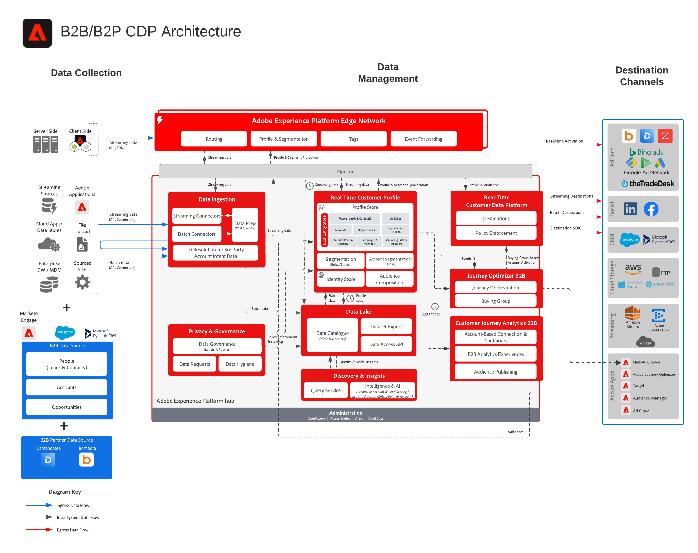

# B2B對象和設定檔啟用

使用&#x200B;**Real-Time Customer Data Platform B2B edition**&#x200B;將帳戶、商機及個人資料整合至統一的B2B設定檔中，然後在多個目的地（例如LinkedIn、Marketo Engage和雲端儲存空間）中啟用人員對象和帳戶對象。 此藍圖說明如何設計B2B結構描述、建立多實體對象，以及匯出這些對象以跨多個管道和目的地啟動，以及在&#x200B;**Journey Optimizer B2B Edition**&#x200B;和&#x200B;**Customer Journey Analytics B2B edition**&#x200B;等應用程式中進行協調和分析。

## 使用案例

- 根據B2B資料（包括帳戶、商機和銷售機會），建立人員的受眾，以跨管道進行目標定位和個人化。
- 使用&#x200B;**區段數**&#x200B;方法，建立將帳戶和機會層級屬性與人員層級行為結合的多實體對象（例如「過去3天造訪定價頁面，且為產業Y中帳戶處於階段X中的機會決策者」的人員）。
- 針對目標定位和個人化的受支援Experience Platform目的地啟用人員受眾，針對目標定位、銷售推廣和分析的受支援廣告和雲端儲存目的地啟用帳戶受眾。 目的地支援因對象型別而異；如需帳戶啟用，請參閱[帳戶對象目的地](#account-audience-destinations)。

### 以帳戶為基礎的使用案例

- **填補購買群組的空白：**&#x200B;建立沒有聯絡人的客戶對象，例如CMO或CIO。 將其啟動至LinkedIn相符對象或其他支援的廣告目的地，然後使用目的地的職稱定位來聯絡這些角色中的新聯絡人。
- **向現有客戶的其他部門追加銷售或交叉銷售：**&#x200B;建立在3到9個月前購買產品X但尚未擁有產品Y的帳戶對象。將其啟動至支援的廣告目的地，或匯出至雲端儲存空間，以進行銷售和行銷推廣。
- **使用競爭產品的目標公司：**&#x200B;使用合作夥伴或意圖資料來識別使用競爭者產品的帳戶，即使沒有已知連絡人。 啟用受支援廣告目的地的帳戶受眾，以聯絡這些公司的聯絡人。

## 應用程式

- Real-Time Customer Data Platform B2B edition
- （選用） **Customer Journey Analytics B2B edition**
- （選擇性） **Journey Optimizer B2B Edition**

## 整合模式

此Blueprint的典型B2B整合模式包括：

- **B2B參與和CRM來源RTCDP B2B →目的地**

  B2B參與和CRM系統（例如Marketo Engage、Salesforce和Microsoft Dynamics）會使用標準B2B結構描述和關係，將銷售機會/聯絡人、帳戶和機會傳送到&#x200B;**Real-Time CDP B2B edition**。 People受眾會從此啟用至支援的目的地，包括：

  - Marketo Engage
  - LinkedIn / LinkedIn符合的對象
  - Google Customer Match &amp; DV360
  - 交易台
  - Amazon Ads
  - Trade Desk CRM、Criteo、Bing和其他廣告平台
  - 雲端儲存空間目的地（例如Amazon S3、ADLS和Snowflake）以供下游使用

  帳戶對象使用相同的統一B2B資料模型，並針對[帳戶對象目的地](#account-audience-destinations)下列出的受支援廣告和檔案目的地單獨啟用。

- **RTCDP B2B→的B2B意圖和事件來源→對象→目的地**

  B2B意圖和事件來源，例如Bombora Intent、Demandbase Intent、PathFactory和RainFocus串流意圖，以及進入RTCDP B2B的參與事件。 這些事件對應至標準B2B結構描述，並用來建立可啟用至廣告和行銷目的地的人員和帳戶對象。 例如，顯示競爭者主題意圖的帳戶可以啟用至支援的帳戶目的地，例如Bombora和Demandbase。

使用標準&#x200B;**B2B結構描述和關係**，各種B2B資料來源可用來將帳戶、銷售機會、商機及個人資料對應至Real-Time Customer Data Platform的B2B edition。

## 架構

{width="1000" zoomable="yes"}

## 帳戶對象目的地

帳戶對象可以啟用至以下廣告和雲端儲存空間目的地：

- LinkedIn相符對象
- 龐博拉
- Demandbase
- Azure Data Lake儲存第2代
- 資料登陸區域
- SFTP
- Azure Blob
- AWS S3

請參閱[啟用帳戶對象](https://experienceleague.adobe.com/zh-hant/docs/experience-platform/destinations/ui/activate/activate-account-audiences?lang=en)，以取得最新支援的目的地與必要的對應。 整合模式中列出的人物 — 對象目的地不一定可支援帳戶對象。

## 護欄

設計B2B對象和設定檔時，請參閱下列護欄和適用性檔案：

- [Real-Time Customer Data Platform B2B edition的護欄](https://experienceleague.adobe.com/zh-hant/docs/experience-platform/rtcdp/intro/rtcdpb2b-intro/b2b-guardrails?lang=en)
- [帳戶對象](https://experienceleague.adobe.com/zh-hant/docs/experience-platform/segmentation/ui/account-audiences?lang=en)
- [啟用帳戶對象](https://experienceleague.adobe.com/zh-hant/docs/experience-platform/destinations/ui/activate/activate-account-audiences?lang=en)
- [Real-Time CDP B2B edition的分段使用案例](https://experienceleague.adobe.com/zh-hant/docs/experience-platform/rtcdp/segmentation/b2b)
- [設定檔和分段護欄](https://experienceleague.adobe.com/zh-hant/docs/experience-platform/profile/guardrails)
- [串流細分資格標準更新](https://experienceleague.adobe.com/zh-hant/docs/experience-platform/segmentation/eligibility-criteria-update)

### 多個執行個體和IMS組織支援

以下概述了對應 Experience Platform 和 Marketo Engage 執行個體的支援模式。

#### Marketo作為Experience Platform的資料來源

- 支援將多個Marketo Engage執行個體對應至一個Experience Platform執行個體。
- 不支援將一個 Marketo Engage 執行個體對應到許多 Experience Platform 執行個體。
- 支援將一個 Marketo Engage 執行個體對應到一個 Experience Platform 執行個體和多個沙箱。

#### Marketo作為Experience Platform的目的地

- Experience Platform至許多Marketo Engage例項皆受支援。
- 支援多個Experience Platform執行個體對一個Marketo Engage執行個體。

#### Experience Platform設定檔和分段護欄

請在這裡檢視Experience Platform設定檔和分段護欄： [設定檔和分段護欄](https://experienceleague.adobe.com/zh-hant/docs/experience-platform/profile/guardrails)。

包含B2B實體（例如帳戶、潛在客戶或商機）的區段依賴多實體關係，並在&#x200B;**批次**&#x200B;中進行評估。 相較之下，**串流區段**&#x200B;僅支援未納入B2B實體之人員和事件的對象。 針對近乎即時B2B啟用案例，考慮使用批次評估的B2B對象作為支援情況下串流或邊緣對象的輸入專案。

#### Experience Platform - Marketo Engage Source Connector

- 請參閱檔案[這裡](https://experienceleague.adobe.com/zh-hant/docs/experience-platform/sources/connectors/adobe-applications/marketo/marketo)。

#### Experience Platform - Marketo目的地聯結器

- 請參閱檔案[這裡](https://experienceleague.adobe.com/zh-hant/docs/experience-platform/destinations/catalog/adobe/marketo-engage-connection)。

#### 目標護欄

- 請參閱目的地檔案，以取得每個目的地的特定指引： [目的地護欄](https://experienceleague.adobe.com/zh-hant/docs/experience-platform/destinations/guardrails)。
- 針對Facebook、Google Customer Match &amp; DV360、Microsoft Bing、The Trade Desk、Amazon Ads、Bombra、Demandbase等廣告目的地，請確保您在結構描述和身分識別策略（電子郵件、行動廣告ID、位址列位、帳戶ID）中選擇的識別碼符合這些目的地的對應功能和支援的身分識別。

## 實施步驟

如需如何實作與設定Real-Time Customer Data Platform B2B edition的指引，請參閱Real-Time CDP B2B edition檔案： [Real-Time Customer Data Platform的B2B edition](https://experienceleague.adobe.com/zh-hant/docs/experience-platform/rtcdp/intro/rtcdpb2b-intro/b2b-overview)。

有兩個相同的實施模式：

- 從Marketo Engage （及其連線的CRM）將B2B資料和設定檔擷取至RTCDP B2B edition。
- 使用相關的來源聯結器，直接從CRM或其他B2B系統擷取B2B資料至RTCDP B2B edition。

在RTCDP B2B架構升級中，部分先前使用的模式現在已對B2B實體淘汰。 如需更深入的詳細資料，請參閱詳細檔案[這裡](https://experienceleague.adobe.com/zh-hant/docs/experience-platform/rtcdp/intro/rtcdpb2b-intro/b2b-architecture-upgrade)。

如需帳戶對象建立和啟用的相關資訊，請參閱：

- [建立帳戶對象](https://experienceleague.adobe.com/zh-hant/docs/experience-platform/segmentation/ui/account-audiences?lang=en)。
- [啟用帳戶對象](https://experienceleague.adobe.com/zh-hant/docs/experience-platform/destinations/ui/activate/activate-account-audiences?lang=en)。
- LinkedIn相符對象的[必要對應](https://experienceleague.adobe.com/zh-hant/docs/experience-platform/destinations/ui/activate/activate-account-audiences?lang=en#required-mappings)。

## 實施考量

主要考量事項和設定指南藍圖

- **CRM與Marketo的整合（不含）**

  - 如果實作使用Marketo Engage做為來源，且Marketo Engage已連線至CRM，則同步至Marketo的CRM資料（例如，銷售機會/聯絡人、帳戶、機會）將透過RTCDP來源聯結器流入Marketo B2B edition。
  - 如果有其他未透過Marketo傳遞的CRM表格或屬性（例如自訂物件或其他欄位），請使用CRM來源聯結器直接將CRM來源連線至Experience Platform，並將這些表格對應至標準B2B結構描述和關係。
  - 一起設計CRM + Marketo擷取，以避免RTCDP B2B中B2B實體的重複或衝突表示，並確保所有B2B實體都符合標準結構描述。

- **LinkedIn符合的對象最小對象人數**

  LinkedIn相符對象具有最低對象人數要求（例如300個相符成員）。 如果啟用的帳戶對象不符合要求，請先擴大對象定義，以增加可比對的對象規模，然後再啟動行銷活動。 如需目前需求，請參閱[LinkedIn目的地檔案](https://experienceleague.adobe.com/zh-hant/docs/experience-platform/destinations/catalog/social/linkedin?lang=en)。

## 相關文件

- [Real-Time Customer Data Platform的B2B edition](https://experienceleague.adobe.com/zh-hant/docs/experience-platform/rtcdp/intro/rtcdpb2b-intro/b2b-overview)
- [Real-Time Customer Data Platform B2B edition快速入門](https://experienceleague.adobe.com/zh-hant/docs/experience-platform/rtcdp/intro/rtcdpb2b-intro/b2b-tutorial?lang=en)
- [建立和啟用帳戶對象教學課程](https://experienceleague.adobe.com/zh-hant/docs/platform-learn/tutorials/audiences/create-audiences-with-b2b-data?lang=en)
- [建立帳戶對象](https://experienceleague.adobe.com/zh-hant/docs/experience-platform/segmentation/ui/account-audiences?lang=en)
- [啟用帳戶對象](https://experienceleague.adobe.com/zh-hant/docs/experience-platform/destinations/ui/activate/activate-account-audiences?lang=en)
- [LinkedIn目的地聯結器](https://experienceleague.adobe.com/zh-hant/docs/experience-platform/destinations/catalog/social/linkedin?lang=en)
- [Real-Time Customer Data Platform B2B edition的護欄](https://experienceleague.adobe.com/zh-hant/docs/experience-platform/rtcdp/intro/rtcdpb2b-intro/b2b-guardrails?lang=en)
- [Real-Time Customer Data Platform B2B edition中的結構描述](https://experienceleague.adobe.com/zh-hant/docs/experience-platform/rtcdp/schemas/b2b)
- [Real-Time CDP B2B edition的架構升級](https://experienceleague.adobe.com/zh-hant/docs/experience-platform/rtcdp/intro/rtcdpb2b-intro/b2b-architecture-upgrade)
- [Adobe Experience Platform](https://experienceleague.adobe.com/zh-hant/docs/experience-platform)
- [Marketo Engage](https://experienceleague.adobe.com/zh-hant/docs/marketo/using/home)
- [Adobe Experience Platform - Marketo Source Connector](https://experienceleague.adobe.com/zh-hant/docs/experience-platform/sources/connectors/adobe-applications/marketo/marketo)
- [Adobe Experience Platform - Marketo目的地聯結器](https://experienceleague.adobe.com/zh-hant/docs/marketo/using/product-docs/core-marketo-concepts/smart-lists-and-static-lists/static-lists/push-an-adobe-experience-platform-segment-to-a-marketo-static-list)
- [目標護欄](https://experienceleague.adobe.com/zh-hant/docs/experience-platform/destinations/guardrails)
