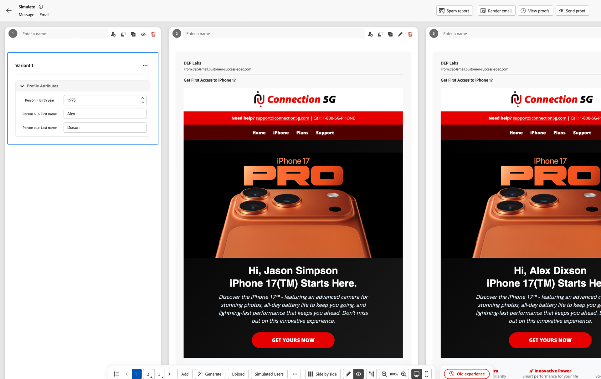

# 內容模擬

**用途：**&#x200B;使用Adobe Journey Optimizer的模擬和校樣工具來驗證個人化、條件邏輯和內容變體。

## 學習目標

在本單元結束時，您將能夠：

1. 上傳並使用測試設定檔資料進行模擬。
1. 驗證個人化欄位和變體邏輯。
1. 測試遺失或不相符資料的遞補行為。

## 簡介

在此單元中，您將使用Adobe Journey Optimizer中的模擬工具，以&#x200B;**兩個條件式變體**&#x200B;測試您的電子郵件。
這可讓您預覽不同客戶將會如何體驗您的個人化訊息，在啟動行銷活動之前確保準確性。

您將會使用工具組中的範例測試設定檔檔案&#x200B;**sample.csv**。

中的測試設定檔檔案sample.csv範例

## 開啟模擬工具

1. 開啟您已完成的電子郵件。
2. 在電子郵件中，按一下&#x200B;**模擬內容**。

![按一下[模擬內容]並選取[模擬內容變數]](assets/content-simulation-click-simulate-content-variation.png)

幾秒後會開啟模擬面板。

## 上傳測試設定檔資料

1. 按一下底部的&#x200B;**上傳**&#x200B;以上傳輸入資料。

   在模擬面板中輸入資料的

&#x200B;3. 選擇&#x200B;**sample.csv**&#x200B;並按一下&#x200B;**繼續**。

   ![選擇sample.csv並按一下[開啟]](assets/content-simulation-choose-sample-csv-continue.png)

AJO會處理檔案，並及時準備預覽。

## 檢閱變體演算

當您按一下類比電子郵件中的內容時，AJO會根據上傳的設定檔並排顯示變體。

**預期結果：**

- **Alex**→看到&#x200B;**變體1** （年齡超過40歲）
按一下第一個變體上方的鉛筆圖示以&#x200B;**顯示變體詳細資料**

卡片會翻轉以顯示個人化所根據的詳細資訊
歲的Alex設定檔轉譯Variant 1

- **Jason** →看到&#x200B;**變體2** （年齡低於40歲）
按一下第二個變體上方的鉛筆圖示以&#x200B;**顯示變體詳細資料**

將檢視從並排切換為&#x200B;**垂直棧疊**，以並排檢視Jason的詳細資料和個人化內容

歲的Jason設定檔轉譯Variant 2

在捲動電子郵件內容時，我們可以看到Jason的全名以及我們選擇的條件式內容影像。 太酷了！

中為Jason顯示的個人化全名欄位

## 驗證遞補行為

**遞補和預設值：**&#x200B;檢查您的電子郵件是否妥善處理任何遺失資料或不相符的情況。 例如，模擬具有空白出生年欄位的設定檔，或不符合任何目標優惠方案資格的設定檔。 預覽應顯示預設內容區塊或合理的預留位置，而非損壞或空白內容。 如果您的模擬顯示內容應位於的空白區段，這表示您可能需要在設計中設定遞補優惠或預設文字。

## 重述

在本模式中，您成功：

- 使用範例設定檔的模擬個人化內容
- 已驗證的變體切換邏輯
- 已確認的個人化欄位會正確填入

您現在已準備好進行下一個模組 — **品牌一致性**，
您將使用AI根據Connection 5G品牌准則評估電子郵件。
