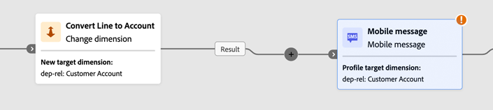

# 篩選行

## 目標

在接下來的幾個步驟中，您將篩選掉實際上不允許以SMS訊息鎖定的所有行，因為這些行在行層級選擇退出。  您無法在此信賴設定檔同意，因為這是行層級目標。

## 設定分割活動

1. 按一下Fork活動底部轉變上的&#x200B;**+**&#x200B;圖示，然後在快顯視窗中選取&#x200B;**分割**&#x200B;活動。

   

2. 在右邊欄更新標籤以指出下列專案： `Filter out opt'd out lines`

   

3. 在右側邊欄中，展開預設區段&#x200B;**子集**&#x200B;區段，然後按一下&#x200B;**建立篩選器**&#x200B;按鈕

   

4. 新增條件，以確保您移除所有選擇退出簡訊的客戶連結，然後按一下&#x200B;**確認**。

   

   >[!NOTE]
   >
   >您必須找出如何建立條件，但最終結果符合上方的熒幕擷圖。  知道了！

5. 按一下右上角的「儲存」按鈕以儲存作業。  您的畫布現在看起來像這樣\...

儲存分割活動後

## 新增變更維度

1. 在工作流程畫布上，在您新增的分割條件後按一下&#x200B;**+**&#x200B;圖示，並選取&#x200B;**變更維度**&#x200B;活動

   

2. 更新變更維度的屬性，如下所述，然後按一下&#x200B;**確認**：
標籤： `Convert Line to Account`
新的目標維度： `dep-rel: Customer Account`

   

   

## 新增簡訊活動

1. 在您新增的變更維度之後，按一下&#x200B;**+**&#x200B;圖示，並選取&#x200B;**行動訊息活動**

   

   

2. 在右側邊欄中，請先將Target選擇變更為&#x200B;**每個次要維度一個訊息**，然後按一下&#x200B;**編輯行動訊息**&#x200B;按鈕以開始設定SMS訊息

   

3. 在頂端導覽列中，按一下「動作」功能表專案，然後從行動訊息設定下拉式清單中選取您先前建立的頻道。

## 重述

您篩選掉所有因選擇退出而不允許以SMS訊息鎖定的行，將維度從行變更為帳戶，並為允許鎖定的對象新增SMS活動。
